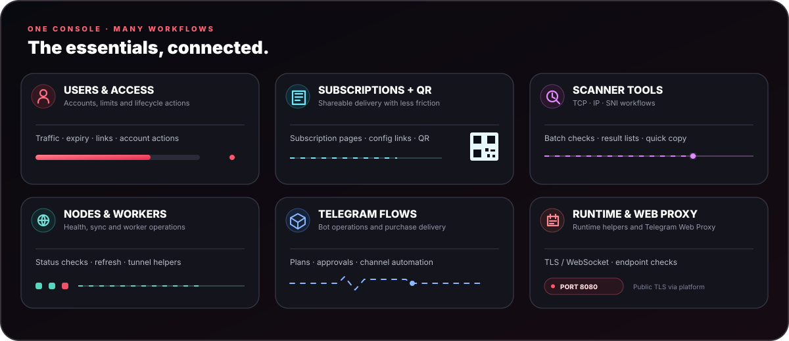
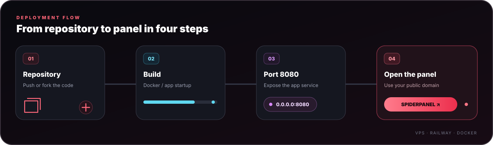
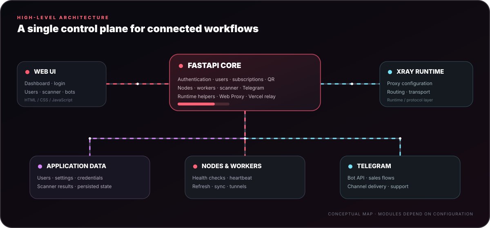

<div align="center">
  

  <p>
    <a href="https://github.com/amirh00sain/SpiderPanel"></a>
    
    
    
  </p>
  <p><b>Manage users, subscriptions, nodes, scanners and Telegram workflows from one control panel.</b></p>
  <p>VPS · Railway · Docker-oriented deployment · Responsive UI</p>
</div>

---

<details>
<summary><b>📚 Table of contents</b></summary>

- [Animated network map](#-animated-network-map)
- [Why SpiderPanel?](#-why-spiderpanel)
- [Deployment](#-deployment)
- [Public endpoint & subscription flow](#-public-endpoint--subscription-flow)
- [Telegram automation](#-telegram-automation)
- [Account, expiry & delivery behavior](#-account-expiry--delivery-behavior)
- [Scanner](#-scanner)
- [Nodes & workers](#-nodes--workers)
- [Project structure](#-project-structure)
- [Runtime & API](#-runtime--api)
- [Built-in Web Proxy](#-built-in-web-proxy-inbound-telegram-web-proxy)
- [Vercel Domain relay](#vercel-domain-tls--websocket-relay)
- [Cloudflare Pages Domain](#cloudflare-pages-domain)
- [UI details](#-ui-details)
- [Security notes](#-security-notes)
- [Development](#-development)
- [مستندات فارسی](#-مستندات-فارسی)

</details>

## 🌐 Animated network map

<div align="center">
  
  <sub><b>Animated topology artwork.</b> Route paths are illustrative; this graphic does not display live server telemetry.</sub>
</div>

The globe gives the README a visual network overview. Its routes and node pulses are decorative animations, not a source of live traffic, server health or geolocation data.

---

## ✦ Why SpiderPanel?

SpiderPanel brings the operational pieces of a proxy service into one panel: users, subscriptions, generated links, QR codes, nodes, workers, scanners, and Telegram automation.

It is designed to be useful both on a direct VPS installation and on container/deployer environments where the public hostname may not be known until runtime.

<div align="center">
  
</div>

### Core capabilities

| Area | What it provides |
|---|---|
| 👤 Users | Create/manage accounts, limits, traffic, links and per-user actions |
| 🔗 Subscriptions | Subscription pages, config links, QR codes and copy actions |
| 🛰 Nodes | Node management, health checks, refresh/sync operations |
| 🧪 Scanner | TCP / IP / SNI tooling, result lists and copy-friendly outputs |
| 🤖 Telegram Bot | Bot configuration, channel automation and sales workflows |
| 🛒 Sell Bot | Plans, receipts, manual approval and subscription delivery |
| 🟢 Expiry | Automatic expiration handling and cleanup of expired users |
| 🛠 Tools | Runtime info, workers, tunnel status and utility endpoints |

---

# 🚀 Deployment

<div align="center">
  
</div>

## Option A — One-command VPS install

Run the installer on a supported Linux VPS:

```bash
curl -fsSL https://raw.githubusercontent.com/amirh00sain/SpiderPanel/main/start.sh | bash
```

The project installer is intended to handle dependency setup, application files and runtime management. The panel itself is configured to listen on **port `8080`**.

### Useful installer variables

| Variable | Default | Purpose |
|---|---|---|
| `SPIDER_APP_DIR` | `/opt/SpiderPanel` | Application directory |
| `SPIDER_REPO` | `https://github.com/amirh00sain/SpiderPanel.git` | Git repository |
| `SPIDER_BRANCH` | `main` | Branch to deploy |
| `SPIDER_INSTALLER_URL` | project `start.sh` URL | Installer source |
| `SPIDER_UV_VERSION` | `0.12.9` | uv release used by installer |
| `SPIDER_XRAY_VERSION` | `26.3.27` | Xray release used by installer |

> Keep secrets out of the repository. Prefer environment variables or protected server configuration for any sensitive deployment data.

---

## Option B — Railway

1. Fork the repository into your GitHub account.
2. Create a new Railway project from the GitHub repository.
3. Let Railway build from the included `Dockerfile` / `railway.toml` configuration.
4. Expose the application on **port `8080`**.
5. Generate a public domain.
6. Open the generated domain and continue into the panel.

### Railway notes

- The application process listens on `0.0.0.0:8080`.
- `railway.toml` uses Uvicorn with the same fixed port.
- Public-domain discovery is important for subscription URLs and user-facing links.
- Avoid hard-coding `localhost` as a public subscription hostname.

---

# 🧭 Public endpoint & subscription flow

SpiderPanel contains runtime/public-endpoint helpers so the panel can work in environments where the final public hostname is assigned after deployment.

Typical user-facing flows include:

```text
Panel
  ├─ /spider                → main panel
  ├─ /login                 → login page
  ├─ /dashboard             → dashboard page
  ├─ /link/<uuid>           → user link view
  ├─ /p/<uuid_key>          → public subscription page
  └─ /api/sub/<uuid_key>    → subscription endpoint
```

The project also exposes QR endpoints for subscription/user configuration delivery.

---

# 🤖 Telegram automation

SpiderPanel includes Telegram-oriented workflows for administration, channel operations and sales.

### Channel Bot

The Channel Bot flow can create a new user, generate the subscription + QR, publish the generated content to the configured channel, and then perform the related cleanup step after successful delivery.

### Sell Bot

The customer-facing flow is intentionally simple:

```text
🟢 My Account   →   🛍 Products   →   💬 Support
```

Plans are managed independently and can carry their own name, price, inbound, traffic quota, duration and user prefix.

A typical purchase flow is:

```text
/start
   ↓
🛍 Products
   ↓
Select Plan
   ↓
Payment info
   ↓
Receipt upload
   ↓
Admin review
   ├─ ✅ Approve → Subscription + QR
   └─ ❌ Reject
```

The panel also supports forced channel membership checks, numeric Telegram admin IDs, plan management and expiration handling.

---

# 🛡 Account, expiry & delivery behavior

### Account identity

The Telegram sales flow associates a customer with a **Telegram Numeric User ID**. Existing accounts can be updated rather than blindly creating duplicates, while order activation is designed to avoid double-applying the same purchase.

### Expiration

When a user's configured expiration is reached, the expiry sweeper attempts to remove the account and clean its Telegram mapping, then reports the expiration to the user.

### Delivery safety

The project separates activation from delivery so a temporary Telegram delivery failure does not automatically mean the underlying account was duplicated or a previous account was incorrectly reported as removed.

---

# 🔎 Scanner

The scanner area includes tooling around:

- TCP / IP checks
- Cloudflare subnet data
- SNI lists and checks
- IP/SNI scan result handling
- batch ping operations
- fastest-result helpers

The mobile UI is tuned for compact, touch-friendly results so a domain or IP can be tapped and copied directly.

---

# 🌐 Nodes & workers

Node and worker tooling includes health checks, refresh/sync operations, worker setup and heartbeat/health helpers.

<div align="center">
  
</div>

At a high level:

```text
Web UI
  │
  ▼
FastAPI application
  ├── users / auth
  ├── subscriptions / QR
  ├── nodes / workers
  ├── scanner
  ├── Telegram bot
  └── runtime helpers
        │
        ├── Xray / proxy runtime
        └── application data
```

---

# 📁 Project structure

```text
.
├── data/
│   ├── cf_subnets.txt
│   ├── endpoint.txt
│   ├── sni-list.txt
│   ├── sni_reality.txt
│   └── sni_reality_for_scan.txt
├── static/
│   ├── index.html
│   ├── login.html
│   ├── sub.html
│   ├── spider-logo.svg
│   ├── img/
│   └── musix/
├── svg/                    # README / project SVG artwork
│   ├── logo.svg
│   ├── hero.svg
│   ├── network-map.svg      # animated illustrative 3D globe
│   ├── features.svg
│   ├── deploy.svg
│   └── architecture.svg
├── worker/
│   └── worker.js            # source of truth (deployed to CF as _worker.js)
├── Dockerfile
├── railway.toml
├── requirements.txt
├── start.sh
├── app.py                # Python-host ASGI entry point (app:app)
├── main.py
├── twp.py                  # Telegram Web Proxy core (framing, MTProxy crypto, relay)
└── README.md
```

---

# ⚙️ Runtime & API

The backend is built with **FastAPI/Uvicorn**. The repository contains endpoints for authentication, users, subscriptions, nodes, scanners, workers, Telegram bot configuration and runtime information.

For Python application hosts, set the start command to `python app.py` or the ASGI target to `app:app`. The entry point binds to `0.0.0.0` and honors the host-provided `PORT` (default `8080`). The VPS installer below keeps the panel on port `8080`.

The Docker image exposes the panel on:

```text
0.0.0.0:8080
```

For a clean deployment, map your platform's public hostname to that application port.

---

# 🌐 Built-in `Web Proxy` inbound (Telegram Web Proxy)

SpiderPanel ships a **system inbound named `Web Proxy`** (protocol
`telegram-webproxy`). It is created automatically on first boot and migrated
into existing installations, so an administrator never has to build it by
hand. Assign it to a user like any other inbound and that user gets their own
`t.me/webproxy` link.

| Setting              | Value                                            |
| -------------------- | ------------------------------------------------ |
| Display name         | `Web Proxy`                                      |
| Protocol             | `telegram-webproxy`                              |
| Security             | `TLS`                                            |
| Transport            | `WebSocket (WS)`                                 |
| Public hostname      | the panel's own canonical domain                 |
| Public port          | `443`                                            |
| Internal app port    | `8080` (Railway forwards HTTPS/WSS to it)        |
| Bridge endpoint      | `https://<PANEL_HOSTNAME>/`                      |
| Session endpoint     | `https://<PANEL_HOSTNAME>/api/v1/session`        |
| WebSocket endpoint   | `wss://<PANEL_HOSTNAME>/api/v1/ws`               |

### No extra listener, no separate TLS

Railway terminates public TLS on 443 and forwards HTTPS/WebSocket traffic to
SpiderPanel on 8080 — the **same** application that serves the dashboard.
Uvicorn is never bound to 443, no second TLS listener is started, no unrelated
subdomain is created, and no separate Railway TCP Proxy is required.

TWP reuses that transport while keeping its own binary frame protocol, MTProxy
handshake validation, cryptographic state, TCP upstream sockets and full-duplex
relay logic. **TWP frames never travel through the VLESS WebSocket handler**;
`/api/v1/ws` is registered ahead of the VLESS catch-all path so the two cannot
be confused. In the subscription page (`sub.html`) the generated link appears
under the existing **Telegram Proxy** category, next to native MTProxy links.

### The public domain is inherited, never typed

The hostname is derived from the panel's existing `get_host()` resolution, so a
custom trusted panel domain or Railway's `RAILWAY_PUBLIC_DOMAIN` is picked up
automatically. It is **never** taken from an arbitrary incoming HTTP `Host`
header. When the trusted domain changes, the displayed hostname and every newly
generated link follow — the inbound is not recreated and user secrets are
untouched.

### Per-user secrets

Assigning the inbound mints a cryptographically random `secrets.token_hex(16)`
secret, stored separately from the user's native `telegram_secret` and keyed by
`(user_id, inbound_id)`. The link is:

```text
https://t.me/webproxy?server=<PANEL_HOSTNAME>&secret=<USER_SECRET>
```

The `server` parameter carries the bare hostname only — no scheme, no internal
port, no path, and never `:443`. Secrets are reused across ordinary restarts
and config regeneration; an explicit revocation followed by reassignment mints
a replacement. A user's secret is never exposed to anyone else and never
reused from another credential.

### Signing key

`SPIDER_TWP_SIGNING_KEY` is the recommended way to supply the HMAC signing key
used for short-lived bootstrap and session tokens. When it is absent, the panel
generates one **once** and persists it atomically (`O_EXCL`, mode `0600`) at:

```text
DATA_DIR/twp_signing.key
```

- Every replica **must share the same** signing key, otherwise a bootstrap
  issued by one replica will not verify on another. Set `SPIDER_TWP_SIGNING_KEY`
  explicitly when running more than one replica.
- The panel **needs persistent storage** so the fallback key and the persisted
  per-user secrets survive restarts. A fresh or ephemeral volume regenerates
  both and invalidates existing links.
- The signing key is never logged and never returned by any API response.
- If no stable key can be obtained, the inbound reports **`not_ready`** with an
  explanation in the authenticated admin UI instead of advertising links that
  cannot work. Every unrelated SpiderPanel feature keeps running.

### Status, disabling and deletion

The inbound row shows the protocol, transport, domain, public port, live status
(`enabled` / `disabled` / `not_ready`) and its assigned users. Deletion is
blocked; use enable/disable instead. Disabling stops new sessions immediately,
tears down live relays and stops advertising working links. Re-enabling restores
service without recreating anything.

---

# 🎨 UI details

SpiderPanel's interface is built around:

- responsive dark/light presentation
- compact touch interactions
- copy-friendly configuration actions
- collapsible sections where appropriate
- subscription pages with QR delivery
- Telegram glass-button style flows
- desktop + mobile layouts

The `svg/` directory contains standalone documentation artwork: an animated hero, illustrative 3D network globe, feature overview, deployment flow, architecture diagram and wordmark. Animations have static visual fallbacks and respect reduced-motion preferences in SVG-capable viewers. The globe is a visual illustration, not a live traffic or geolocation feed.

---

# 🔐 Security notes

- Never commit Telegram bot tokens, passwords, API keys or private deployment credentials.
- Put sensitive values into protected environment/server configuration.
- Use HTTPS for production panel access.
- Restrict administrative access to trusted operators.
- Review generated subscription links before sharing them publicly.
- `DATA_DIR/twp_signing.key` is a secret: it is written with mode `0600`, but
  keep it out of version control and out of shared backups you do not control.
- Share one `SPIDER_TWP_SIGNING_KEY` across replicas, and use persistent storage
  so the fallback key and per-user Web Proxy secrets survive restarts.

---

# 🧑‍💻 Development

For local experimentation, install the Python dependencies and run the FastAPI application with Uvicorn:

```bash
python -m venv .venv
source .venv/bin/activate
pip install -r requirements.txt
python -m uvicorn main:app --host 0.0.0.0 --port 8080
```

Then open:

```text
http://127.0.0.1:8080/spider
```

For production or public subscriptions, use the real public hostname rather than `127.0.0.1` / `localhost` in user-facing links.

---

# 💬 Links

- GitHub: https://github.com/amirh00sain/SpiderPanel
- Installer: https://raw.githubusercontent.com/amirh00sain/SpiderPanel/main/start.sh
- Telegram: https://t.me/amirspl1der
- Channel: https://t.me/SPiDER_VPN1

---

<div align="center">
  

  <h3>SPiDER PANEL</h3>
  <p><i>Connect the pieces. Keep the whole panel in view.</i></p>
</div>

---

# 🇮🇷 مستندات فارسی

<div dir="rtl">

## ✦ SpiderPanel چیست؟

**SpiderPanel** یک پنل مدیریتی برای مدیریت کاربران، اشتراک‌ها، کانفیگ‌ها، نودها، اسکنرها و اتوماسیون تلگرام است. رابط کاربری برای دسکتاپ و موبایل طراحی شده و پورت اصلی پنل روی **8080** ثابت است.

<div align="center" dir="ltr">
  
</div>

<div align="center" dir="ltr">
  
  <sub>این نقشه یک تصویرسازی متحرک است و دادهٔ ترافیک زنده نمایش نمی‌دهد.</sub>
</div>

### امکانات اصلی

| بخش | توضیحات |
|---|---|
| 👤 کاربران | ساخت و مدیریت کاربر، حجم، محدودیت، لینک و عملیات حساب |
| 🔗 اشتراک | صفحه اشتراک، لینک کانفیگ، QR Code و کپی سریع |
| 🛰 نودها | مدیریت نود، سلامت، Refresh و Sync |
| 🧪 Scanner | بررسی TCP، IP، SNI و نتایج قابل کپی |
| 🤖 Telegram Bot | مدیریت Bot، کانال و فرایندهای فروش |
| 🛒 Sell Bot | پلن، رسید، تأیید دستی و تحویل Subscription |
| 🟢 انقضا | حذف/پاک‌سازی حساب‌های منقضی و اطلاع‌رسانی |
| 🛠 ابزارها | Worker، Tunnel، Runtime و ابزارهای کمکی |

---

## 🚀 نصب روی VPS

روی VPS لینوکسی دستور زیر را اجرا کنید:

```bash
curl -fsSL https://raw.githubusercontent.com/amirh00sain/SpiderPanel/main/start.sh | bash
```

پورت پنل:

```text
8080
```

### متغیرهای مفید نصب

| متغیر | مقدار پیش‌فرض | کاربرد |
|---|---|---|
| `SPIDER_APP_DIR` | `/opt/SpiderPanel` | مسیر نصب |
| `SPIDER_REPO` | مخزن SpiderPanel | مخزن پروژه |
| `SPIDER_BRANCH` | `main` | شاخه نصب |
| `SPIDER_INSTALLER_URL` | آدرس `start.sh` پروژه | منبع Installer |
| `SPIDER_UV_VERSION` | `0.12.9` | نسخه uv |
| `SPIDER_XRAY_VERSION` | `26.3.27` | نسخه Xray |

---

## 🚂 نصب روی Railway

1. Repository را در GitHub Fork کنید.
2. در Railway یک پروژه از GitHub بسازید.
3. پروژه را Deploy کنید تا `Dockerfile` و `railway.toml` استفاده شوند.
4. پورت **8080** را برای سرویس قرار دهید.
5. یک Domain عمومی بسازید.
6. با Domain ساخته‌شده وارد پنل شوید.

> برای لینک Subscription از `localhost` استفاده نکنید؛ لینک عمومی باید با Domain واقعی سرویس ساخته شود.

<div align="center" dir="ltr">
  
</div>

---

## 🤖 Telegram Bot و فروش

روند ساده کاربر:

```text
🟢 اعتبار من   ·   🛍 محصولات   ·   💬 پشتیبانی
```

جریان خرید:

```text
/start
  ↓
🛍 محصولات
  ↓
انتخاب Plan
  ↓
اطلاعات پرداخت
  ↓
ارسال رسید
  ↓
تأیید ادمین
  ├─ ✅ تأیید → Subscription + QR
  └─ ❌ رد
```

ادمین فروش با **Numeric Telegram User ID** مشخص می‌شود و مدیریت Planها و سفارش‌های معلق از داخل پنل/بات انجام می‌شود.

عضویت اجباری در کانال نیز قابل تنظیم است و پیش از ورود کاربر به بخش‌های فروش می‌تواند بررسی شود.

---

## 🟢 اعتبار و انقضا

در بخش اعتبار، اطلاعات حساب خریدار مانند شناسه عددی تلگرام، وضعیت، حجم، تاریخ انقضا و لینک Subscription قابل نمایش است.

وقتی زمان اعتبار تمام شود، سیستم expiry sweeper برای حذف حساب و پاک‌سازی mapping تلاش می‌کند و کاربر را از پایان اعتبار مطلع می‌کند.

---

## 🔎 Scanner

در بخش Scanner ابزارهای زیر قرار دارند:

- TCP / IP
- SNI
- Cloudflare subnet
- Ping batch
- Scan result handling
- نمایش نتایج با قابلیت کپی مستقیم روی موبایل

نتیجه‌های TCP در حالت موبایل فشرده شده‌اند تا IP و دامنه به‌راحتی لمس و کپی شوند.

---

## 🌐 Node / Worker

ابزارهای Node و Worker برای Health Check، Refresh، Sync، Setup و Heartbeat در پنل قرار دارند.

<div align="center" dir="ltr">
  
</div>

ساختار کلی:

```text
Web UI
  ↓
FastAPI
  ├─ Users / Auth
  ├─ Subscription / QR
  ├─ Nodes / Workers
  ├─ Scanner
  ├─ Telegram
  └─ Runtime helpers
```

---

## 📁 ساختار پروژه

```text
.
├── data/
├── static/
├── svg/                 # SVG های README و هویت بصری پروژه
├── worker/
├── Dockerfile
├── railway.toml
├── requirements.txt
├── start.sh
├── main.py
└── README.md
```

---

## ⚙️ اجرای محلی

```bash
python -m venv .venv
source .venv/bin/activate
pip install -r requirements.txt
python -m uvicorn main:app --host 0.0.0.0 --port 8080
```

سپس:

```text
http://127.0.0.1:8080/spider
```

برای لینک‌های عمومی و Subscription از Domain واقعی استفاده کنید، نه `localhost`.

---

## 🔐 نکات امنیتی

- Token، Password، API Key و اطلاعات حساس را داخل Git Commit نکنید.
- مقادیر حساس را در Environment یا تنظیمات محافظت‌شده نگهداری کنید.
- پنل عمومی را با HTTPS اجرا کنید.
- دسترسی ادمین را محدود نگه دارید.
- لینک Subscription را قبل از انتشار عمومی بررسی کنید.

---

## 🔗 لینک‌ها

- GitHub: https://github.com/amirh00sain/SpiderPanel
- Installer: https://raw.githubusercontent.com/amirh00sain/SpiderPanel/main/start.sh
- Telegram: https://t.me/amirspl1der
- Channel: https://t.me/SPiDER_VPN1

</div>

<div align="center">
  
</div>


## Vercel Domain (TLS + WebSocket relay)

The System accordion includes **Vercel Domain**. It deploys a Node.js WebSocket bridge to a Vercel project. Per-user configs use `security=tls`, `type=ws`, and the path `/ws/vl/{uuid}` on the Vercel production domain. The bridge opens a WSS connection to the same path on the panel's detected public Railway domain. The Vercel token stays server-side in persisted panel state and is never returned by the status API.

Use a Vercel API token with permission to create deployments/projects, manage project protection, and delete the managed project. Ping uses browser-side `fetch` timing to `/_spider-health` from the administrator's own network (four samples); it is not server-side ping or ICMP. Deleting the connection removes the managed Vercel project. Vercel WebSocket function connections end at the configured function maximum duration (300 seconds in this template on compatible Fluid Compute plans), so clients must be able to reconnect.

The relay template lives under `deploy/vercel/`; the Python deploy/delete integration is `vercel_relay.py`. The WebSocket bridge uses Vercel Functions' native WebSocket support and the `ws` package. Older saved XHTTP relay projects are marked as legacy; delete and recreate them to deploy the new `/ws/vl/{uuid}` bridge.

## دامنه Vercel (رله TLS + WebSocket)

در آکاردیون «سیستم»، بخش **Vercel Domain** یک پل WebSocket در Vercel می‌سازد. کانفیگ هر کاربر از `security=tls` و `type=ws` با مسیر `/ws/vl/{uuid}` روی دامنهٔ Production وِرسل استفاده می‌کند؛ پل، اتصال WSS را به همین مسیر روی دامنهٔ عمومی Railway می‌فرستد. توکن Vercel فقط در وضعیت خصوصی سرور ذخیره می‌شود و در API وضعیت برگردانده نمی‌شود.

## Cloudflare Pages Domain

The System accordion includes **Pages Domain**. Enter a Cloudflare API token and SpiderPanel creates a Direct Upload Pages project, deploys `worker/worker.js` as an Advanced Mode `_worker.js`, and binds a dedicated KV namespace. The project is served at `<project>.pages.dev`. Choose **Custom domain** to load zones from the selected account; SpiderPanel creates a random subdomain in the selected zone and attaches it to the Pages project. Deleting the deployment removes the Pages domain association, its matching generated DNS CNAME, the Pages project (including its `pages.dev` hostname), and its KV namespace. The API token is kept in private server state and is never returned to the browser. Choose a panel user to display and copy a VLESS + TLS/WS configuration; opening or refreshing this section syncs current user state to the Pages worker, and user changes trigger a background sync. The token needs Pages Edit, Workers KV Edit, Memberships Read, Zone Read, and DNS Edit to remove the generated DNS record.

در آکاردیون «سیستم»، بخش **Pages Domain** با توکن API کلادفلر یک پروژهٔ Direct Upload در Pages می‌سازد، فایل `worker/worker.js` را به‌صورت `_worker.js` در حالت Advanced آپلود می‌کند و KV اختصاصی را به آن متصل می‌کند. آدرس پیش‌فرض پروژه `<project>.pages.dev` است. با زدن **Custom domain**، zoneهای حساب انتخابی نمایش داده می‌شوند و پنل یک ساب‌دامین تصادفی روی zone انتخاب‌شده ایجاد و به پروژه Pages وصل می‌کند. حذف، اتصال دامنه، CNAME ساخته‌شده، خود پروژه Pages (و hostname آن در `pages.dev`) و KV اختصاصی را پاک می‌کند. توکن فقط در وضعیت خصوصی سرور ذخیره می‌شود. از فهرست، کاربر را انتخاب کنید تا کانفیگ VLESS + TLS/WS نمایش داده و کپی شود؛ بازکردن یا بروزرسانی این بخش و تغییرات کاربران، وضعیت کاربر را با Worker داخل Pages همگام می‌کند. دسترسی‌های توکن: Pages Edit، Workers KV Edit، Memberships Read، Zone Read و DNS Edit برای حذف رکورد DNS ساخته‌شده.

توکن باید اجازهٔ ساخت Deployment/Project، مدیریت محافظت پروژه و حذف پروژهٔ ساخته‌شده را داشته باشد. پینگ با چهار نمونهٔ `fetch` از مرورگر مدیر به مسیر `/_spider-health` انجام می‌شود؛ بنابراین از اینترنت خود کاربر اندازه‌گیری می‌شود و پینگ ICMP نیست. اتصال WebSocket در Vercel با رسیدن به حداکثر زمان تابع (در این الگو ۳۰۰ ثانیه روی پلن‌های سازگار با Fluid Compute) بسته می‌شود؛ کلاینت باید قابلیت اتصال مجدد داشته باشد. پروژه‌های قدیمی XHTTP به‌عنوان Legacy مشخص می‌شوند؛ برای استفاده از مسیر جدید `/ws/vl/{uuid}` آن‌ها را حذف و دوباره ایجاد کن.
